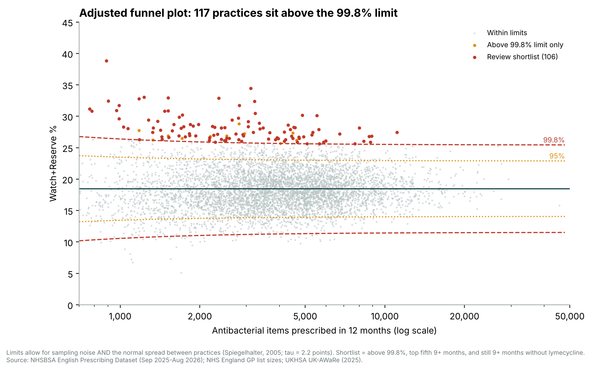
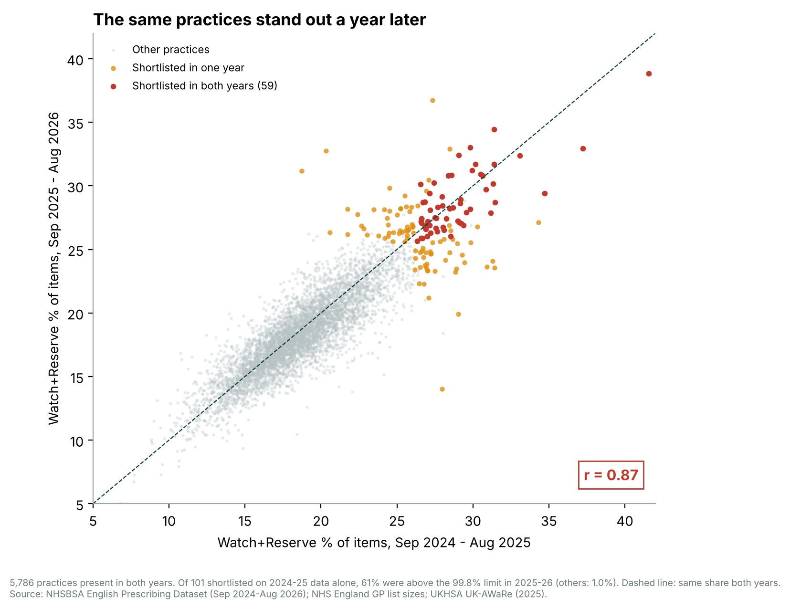
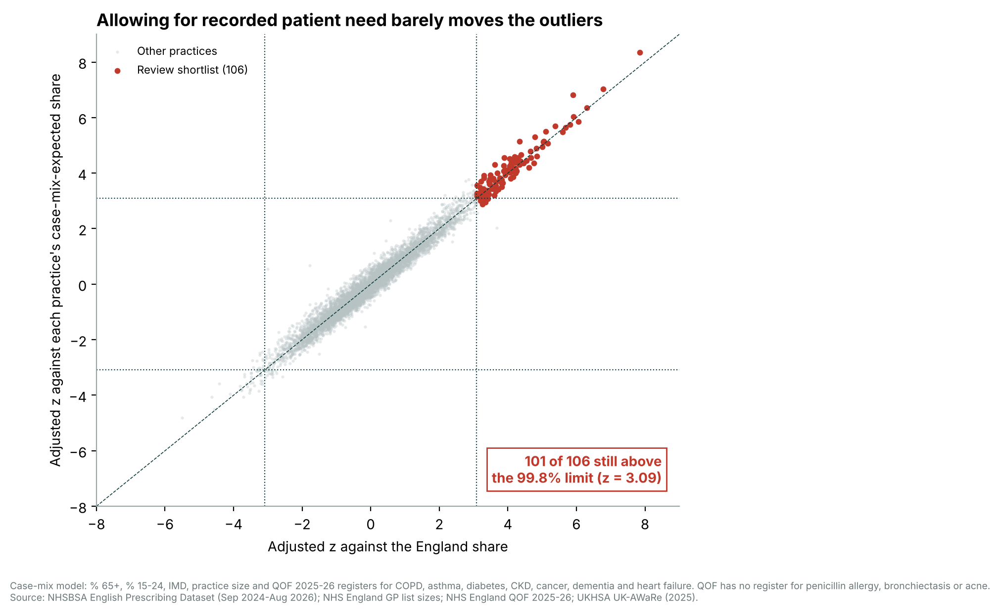

# 36 GP practices have leaned on higher-risk antibiotics three years running

**Higher-risk antibiotic prescribing in English general practice, 2023–2026**

**Authors:** Ashish Agarwal and Aashish Gill

📄 **[Summary (PDF)](Summary.pdf)** · 📘 **[Report](Antibiotic_Stewardship_Report_Short.docx)** · 📊 **[Interactive dashboard](https://public.tableau.com/app/profile/ashish.agarwal6382/viz/AntibioticStewardshipinEnglishGPPractices/Dashboard)**

Every antibiotic prescription is a small bet against resistance. The NHS sorts antibiotics into **Access** (lower risk) and **Watch** and **Reserve** (higher risk), and wants practices to use Access first. Most GP practices in England do. A small group does not, and it is **the same group every year.**

We followed all 5,791 GP practices in England through three years of NHS prescribing data (Sep 2023 – Aug 2026) to answer one question: **which practices use more higher-risk antibiotics than expected, and is there a good reason?**

## 36 practices. Three years. Same pattern.

- **It is not chance.** After allowing for practice size and normal variation, 117 practices sit above the strict 99.8% limit, where chance alone would put about 6. The 106 that also stay high month after month form the review shortlist.
- **It lasts.** Of the practices flagged in one year, **61% were still above the limit a year later** (95% CI 52–70%), against 1% of the rest. **36 practices were flagged in all three years.**
- **Sicker patients don't explain it.** After allowing for recorded disease (COPD, asthma, diabetes and four more), age and deprivation, **101 of the 106 stay flagged.**
- **They swap, they don't over-prescribe.** Flagged practices prescribe no more antibiotics overall. They use less Access (294 vs 343 items per 1,000 patients a year) and more Watch and Reserve (118 vs 78).
- **Fixing them alone is not enough.** The 106 hold only 4–10% of England's excess higher-risk prescribing. They are the place to start, not the whole job.

**Who should act:** an ICB medicines optimisation team deciding which practices to review first. The 36 three-year practices are the obvious first conversations.

## Four things this adds

OpenPrescribing already publishes every practice's monthly Watch share. A structured literature search (Nov 2026; Google Scholar, PubMed, medRxiv, Research Square) found no published English work that adds what this project does for that measure:

1. a **funnel plot** that separates real outliers from chance and normal variation;
2. a **test on later data**: flags from earlier years followed forward, using data that played no part in flagging;
3. a **check against recorded patient need** (QOF disease registers);
4. a **sizing** of how much of the national excess the outliers actually hold.

## Tools and data

**SQL** (NHSBSA Open Data Portal API) · **Python** (data pull, statistics, charts and an independent cross-check of every number) · **Excel** (every result is a live formula; start at the `Start here` sheet, about 22 MB) · **Tableau Public** (workbook in [`tableau/`](tableau/))

**Data:** 12 months of NHS prescribing for 5,791 GP practices (69,492 practice-month rows, Sep 2025 – Aug 2026) and the two years before (Sep 2023 – Aug 2025), plus patient lists, age bands, IMD 2025 deprivation, QOF 2025-26 disease registers and the UK-AWaRe classification.

---

## Full results

| # | Finding | Workbook sheet |
|---|---|---|
| A | **The same practices across three years.** **36 practices are shortlisted in all three years** (Sep 2023 – Aug 2026; 88 in at least two). The 2023-24 shortlist was still above the 99.8% limit two years later in 44% of cases (95% CI 35–53%; others: 1.2%), so the signal appears to fade with time but persists (the 61% and 44% intervals nearly meet, so the fading is suggestive, not firm). 2022-23 is skipped: the Dec 2022 Group A strep outbreak sharply raised Watch prescribing (Cunningham et al., 2024). | `15 Three years` |
| A2 | **And one year later.** The same screen on Sep 2024 – Aug 2025 alone shortlisted 102 practices (101 still open). A year later **61% were still above the 99.8% limit** (95% CI 52–70%) and 58% were shortlisted again, against 1.0% and 0.8% of the others. Practice shares carry over strongly (r = 0.87, 5,786 practices). **59 practices are shortlisted in both years.** Their mean share fell slightly (28.6% → 26.8%), so some single-year flags are chance. | `15 Three years` |
| B | **Not explained by the disease registers available.** Adding QOF 2025-26 registers (COPD, asthma, diabetes, CKD, cancer, dementia, heart failure) plus age, deprivation and size explains 4.1% of the variation in share (16.4% with ICB). With the funnel redrawn around each practice's case-mix-expected share, **101 of the 106 shortlisted practices stay above the 99.8% limit** (95%; 95% CI 89–98%) (all 106 above 95%). This is a weak test: z-scores before and after correlate at 0.98, because the registers predict so little. QOF has no register for penicillin allergy, bronchiectasis or acne. | `16 Patient need` |
| C | **The outliers are only part of the problem.** The shortlist holds 4–10% of the excess Watch+Reserve items, depending on the benchmark: 10% (about 31,000 of ~299,000 a year) against the England share, 4% against the best-tenth practice share (14.5%). Switching all the excess to Access would add 1.2 to 4.1 points of Access (items), on the same two benchmarks. The 48 significantly low practices prescribe as much Access as others (340 vs 342 per 1,000) but half the Watch+Reserve (41 vs 79); only 19 were also low the year before. | `17 Sizing` |
| 1 | **Flags hold within the year too.** Using only Sep–Feb data, 106 practices were flagged by the same rules (a separate group from the shortlist that happens to be the same size). In Mar–Aug, **56% were still above the strict 99.8% limit** (95% CI 46–65%) (all practices: 1.9%; practices not flagged: 0.9%), 90% were above the 95% limit, and only 1 fell below the England share. Their mean share barely moved (28.1% → 27.6%; England 18.9%). | `14 Out of sample` |
| 2 | **Review shortlist: 106 practices** meet three screening criteria (above the adjusted 99.8% funnel limit, in the top fifth 9+ of 12 months, still 9+ months without lymecycline), ranked by adjusted z so big practices are not favoured. The size depends mainly on the z cut-off: about 70–180 for looser or stricter limits, 106 at the standard 99.8%. Comparing each practice with its **own ICB** instead of England keeps 93 of the 106. | `13 Review shortlist`, `14`, `9 Funnel` |
| 3 | **Adjusted funnel plot** (Spiegelhalter, 2005): 117 practices sit above the 99.8% limit after allowing for normal between-practice spread. Across all 5,791 practices, about 6 would be expected above it by chance alone. | `9 Funnel` |
| 4 | **A practice's share is stable across the year** (Sep–Feb vs Mar–Aug r = 0.86), while **single months are noisy:** about 36% of one month's differences between practices are what chance would produce, against 5% over 12 months. | `8 Reliability` |
| 5 | Antibiotic use peaks in winter (43.2 items per 1,000 patients in Dec 2025 vs 29.6 in Aug 2026), but the **Watch+Reserve share is lowest in winter** (17.3% vs 19.3%). The extra winter prescribing is mostly Access. | `1 Monthly` |
| 6 | Older patient lists go with higher rates (y = 9.91x + 249.1, R² = 0.34) but **not** with a higher Watch+Reserve share (r = 0.04). Age, deprivation and size together explain 42% of prescribing volume but only 1.5% of the share: they predict how much a practice prescribes, not which antibiotics. | `5 Age` |
| 7 | **Deprivation (IMD 2025):** deprived practices have younger patients (r = −0.46), which hides their higher prescribing. After controlling for the share aged 65+ and log practice size, each IMD point adds 3.4 items per 1,000 a year (2.9 with ICB fixed effects; p < 0.001 with errors clustered by ICB). The link with Watch+Reserve **share** is tiny and not robust (−0.017 points per IMD point; p = 0.10 with ICB-clustered errors, p = 0.11 in a binomial model with errors clustered by ICB; both are p < 0.001 with ordinary errors). IMD, age, size and ICB together explain only 14% of the differences in share. | `11 Deprivation` |
| 8 | Clarithromycin, co-amoxiclav and azithromycin are **68.5%** of Watch items. Removing lymecycline (acne) changes 27% of the "high all year" list. | `12 Watch drugs`, `10 Sensitivity` |

---

## How it was done

1. **Data pull (SQL through the API, [`src/get_data.py`](src/get_data.py)).** The script loops over the 12 months and writes both SQL files from `data/aware_mapping.csv`, so the code lists can never drift apart. One month of the full prescribing file is ~7.8 GB. The NHSBSA API was queried with SQL to return only antibacterials, already totalled per practice and month and grouped by UK-AWaRe ([`sql/nhsbsa_api_query.sql`](sql/nhsbsa_api_query.sql)). The July 2026 result matched the full downloaded file exactly (2,361,207 items) before prescriptions not linked to a practice were removed; that filter took out 4,505 items. A second query ([`sql/nhsbsa_adq_and_watch_drugs.sql`](sql/nhsbsa_adq_and_watch_drugs.sql)) returned dose-based usage (ADQ) and items per Watch substance; its Watch total matches the first query exactly (4,794,873 items).
2. **Classification:** 81 antibacterial substances were prescribed in the period. 67 were mapped to the four UK-AWaRe groups (Access, Watch, Reserve, Other); 14 not on the UKHSA list (mostly TB and leprosy drugs) were left out of the percentages ([`data/aware_mapping.csv`](data/aware_mapping.csv)).
3. **Cleaning** (counts in the `Cleaning log` sheet): unidentified prescriptions, Y-code services, practices under 1,000 patients, practices missing any month, and **59 atypical lists** (under 150 items per 1,000 patients a year: student health centres and digital-first services).
4. **Deprivation:** each practice's IMD 2025 score = the patient-weighted average of the IMD scores of the neighbourhoods (LSOAs) its patients live in. Inputs: MHCLG [File 5](https://www.gov.uk/government/statistics/english-indices-of-deprivation-2025) and NHS England's [patients registered by LSOA, July 2026](https://digital.nhs.uk/data-and-information/publications/statistical/patients-registered-at-a-gp-practice/july-2026) (both in `data/deprivation/`).
5. **Analysis in Excel, all as formulas:**
   - Rate per 1,000 = items ÷ patients × 1,000 · Watch+Reserve % = (Watch + Reserve) ÷ classified items × 100
   - Split-half r = `CORREL`(share Sep–Feb, share Mar–Aug) · Noise share = average p(1−p)/n ÷ variance of shares
   - Adjusted funnel z = (p − p0) ÷ √(p0(1−p0)/n + τ²), τ² estimated after winsorising z at the 10th/90th percentiles
   - Multiple regression with `LINEST` (coefficients, standard errors, p-values, 95% CIs)
   - Out-of-sample check: the same funnel and persistence rules on Sep–Feb only, then compared with Mar–Aug
6. **Earlier years and patient need ([`src/second_year_casemix.py`](src/second_year_casemix.py)).** The same API query for Sep 2023 – Aug 2024 and Sep 2024 – Aug 2025 (the dataset renamed its columns in March 2025, so `get_data.py` picks the right names for each month; the logic is unchanged). The same cleaning and screen are run on each year alone, then the flags are followed into 2025-26. For patient need, a quasi-binomial model of each practice's Watch+Reserve items uses QOF 2025-26 registers, % aged 65+ and 15–24, IMD and size (ICB left out on purpose: an area is not patient need); the funnel is then redrawn around each practice's expected share. Sheets 15–17 show the results with formulas; the earlier years' z-scores and the model's expected shares are Python inputs, labelled as such.
7. **Cross-check:** [`src/extended_analysis.py`](src/extended_analysis.py) recomputes every headline number independently; all match the workbook. It also runs the checks Excel cannot: regressions with errors clustered by ICB and a binomial (count) model weighted by practice size, also with errors clustered by ICB.

## Robustness (sheet `10 Sensitivity`)

| Version | England W+R % | High in 9+ months |
|---|---|---|
| Main (items, 5,791 practices) | 18.5 | 515 |
| Without lymecycline | 16.1 | 496 (375 the same) |
| OpenPrescribing denominator (A+W+R) | 19.1 | 522 (458 the same) |
| By dose (ADQ) | 22.9 | 360 (198 the same) |
| Keeping the 59 atypical practices | 18.5 | 516 (509 the same) |
| Funnel against each practice's own ICB | 18.5 | shortlist 120 (93 of the 106 the same) |

By dose, 62 of the 106 shortlisted practices stay in the top fifth 9+ months. The other 44 still have a median dose share of 26.8% against 22.9% for England: the dose view re-ranks them, it does not clear them.

**Share or volume?** A share rises with more Watch+Reserve *or* with less Access. Shortlisted practices do not prescribe more antibiotics overall (median 422 vs 438 items per 1,000 patients a year); they prescribe less Access (294 vs 343) and more Watch+Reserve (118 vs 78), which is the substitution stewardship teams look for. But only **74 of the 106** are also in the top fifth on Watch+Reserve items per 1,000 patients; the other 32 have a high share partly because they prescribe little Access. The share also misses 559 practices that are in the top fifth on Watch+Reserve items per 1,000 patients but have a normal share because they prescribe a lot of Access too. Read the shortlist alongside the volume measure (sheet `14 Out of sample`).

**Why my figure differs from OpenPrescribing:** OpenPrescribing's AWaRe measure divides by Access + Watch + Reserve items. This project also includes "Other" antibiotics in the denominator, so it is about 0.7 points lower (18.5% vs 19.1% on their basis).

**Checked against OpenPrescribing (read from their API, Nov 2026):** on their basis, England was 19.18% for Sep 2025 – Aug 2026; this project's cleaned practices give 19.14%. Month by month the gap is 0.03–0.06 points (e.g. Dec 2025: 17.85% vs 17.88%; Aug 2026: 20.24% vs 20.29%), and both show the same winter low and summer high. The small gap is expected because this project drops small, atypical and incomplete practices.

**Classification note:** co-fluampicil is not listed by name in the UKHSA (2025) table; both its ingredients are Access, so it is treated as Access here. OpenPrescribing's table classes it as Other. Only 2 items were prescribed in England in the 12 months, so the choice has no effect.

## Limitations

- **No diagnosis data.** Some Watch prescribing is clinically right: penicillin allergy, or long-term azithromycin to prevent flare-ups of COPD or bronchiectasis (azithromycin is about a fifth of Watch items). QOF registers for COPD, asthma and five other conditions explained little (sheet 16), but there is no register for penicillin allergy, bronchiectasis or acne, so a practice can still look "high" for good reasons. The shortlist is a starting point for conversations, not a judgement.
- **Items and ADQ are not DDDs**, so results cannot be compared directly with the national 73% Access target.
- **Items are not independent decisions.** Repeat prescriptions (e.g. monthly azithromycin or lymecycline) mean chance variation is larger than the binomial formula assumes, so the 36% / 5% noise figures are lower bounds. The τ² adjustment in the funnel absorbs this extra spread.
- **Practices are not named, but this is not anonymity.** The dashboard and report figures show "Practice 1…" or an ID to keep the focus on patterns. The data are public, so a practice can be matched back from its figures, and the workbook keeps NHS codes so every result can be checked.
- **Associations, not causes.** IMD describes where patients live, not the patients. Rurality and care-home share were not tested.
- Age bands and LSOA lists are from July 2026 only; list sizes for 7 of 12 months use the nearest month (median change −0.6%).
- The main funnel compares every practice with England (an own-ICB version is in sheet 9). Persistence was tested over three years (sheet 15), with 2022-23 skipped because of the Group A strep outbreak; the signal appears to fade with time, and what happens after an ICB acts is untested.

## Repository

| Path | What it is |
|---|---|
| `Project1_Antibiotic_Stewardship_12m.xlsx` | The analysis (opens with values in any viewer). Start at the `Start here` sheet. |
| `sql/` | The SQL sent to the NHSBSA API |
| `src/get_data.py` | Pulls the data from the NHSBSA API and NHS England; writes `sql/` |
| `src/common.py` | Loading and cleaning (same steps as the Excel cleaning log) |
| `src/extended_analysis.py` | Independent recalculation of every headline number → `outputs/tables/results.json` |
| `src/second_year_casemix.py` | Earlier years (Sep 2023 – Aug 2025) and the QOF case-mix model → `outputs/tables/results_y2_casemix.json` |
| `src/build_workbook.py` | Writes the Excel workbook (formulas only) |
| `src/chart_polish.py` | Final step for the workbook: makes the grey funnel dots see-through (openpyxl cannot) |
| `src/make_charts.py` | Report figures and the CSV files Tableau uses |
| `src/make_tableau.py` | Builds the Tableau workbook (`tableau/*.twbx`) with its data extracts |
| `requirements.txt` | Python packages |
| `tests/verify.py` | Checks 107 headline numbers in the workbook against the Python recalculation (all match). For sheets 1–14 this is an independent check of Excel formulas. Sheets 15–16 take Python inputs (earlier-year z-scores, case-mix expected shares), so there it checks the counts built on them, not the inputs themselves. |
| `CODE_GUIDE.md` | Plain-English guide to every script and SQL query |
| `LICENSE` | MIT licence for the code (the data keeps its own licence, see below) |
| `outputs/charts/` | Figures used in the report |
| `outputs/tables/` | Results tables, review shortlist, regression |
| `tableau/` | Tableau Public workbook and its CSV files |
| `data/` | Raw API results (`raw/` = Sep 2025 – Aug 2026, `raw/y2425/` = Sep 2024 – Aug 2025, `raw/y2324/` = Sep 2023 – Aug 2024), QOF registers (`raw/qof/`), AWaRe mapping, deprivation inputs |

Run order: `python src/get_data.py` → `python src/extended_analysis.py` → `python src/second_year_casemix.py` → `python src/build_workbook.py` → `python src/chart_polish.py` → (the workbook recalculates itself the first time it is opened in Excel) → `python src/make_charts.py` → `python src/make_tableau.py` → `python tests/verify.py` (after the workbook has been opened and saved once in Excel)

`Antibiotic_Stewardship_Report_Short.docx` is the written report (4 figures, 2 tables).

## Sources

- NHS Business Services Authority (2026) *English Prescribing Dataset (EPD) with SNOMED code*, Sep 2023 – Aug 2026. https://opendata.nhsbsa.net/dataset/english-prescribing-dataset-epd-with-snomed-code
- NHS England (2026) *Patients Registered at a GP Practice* (totals, 5-year age groups, LSOA 2021). https://digital.nhs.uk/data-and-information/publications/statistical/patients-registered-at-a-gp-practice
- Ministry of Housing, Communities and Local Government (2025) *English indices of deprivation 2025*. https://www.gov.uk/government/statistics/english-indices-of-deprivation-2025
- UK Health Security Agency (2025) *UK-AWaRe antibiotic classification*. https://www.gov.uk/government/publications/uk-aware-antibiotic-classification
- Spiegelhalter, D. (2005) 'Handling over-dispersion of performance indicators', *Quality and Safety in Health Care*, 14(5), pp. 347–351. https://doi.org/10.1136/qshc.2005.013755
- Hallsworth, M. et al. (2016) 'Provision of social norm feedback to high prescribers of antibiotics in general practice: a pragmatic national randomised controlled trial', *The Lancet*, 387(10029), pp. 1743–1752. https://doi.org/10.1016/S0140-6736(16)00215-4
- NHS England Digital (2026) *Quality and Outcomes Framework, 2025-26* (practice prevalence). https://digital.nhs.uk/data-and-information/publications/statistical/quality-and-outcomes-framework-achievement-prevalence-and-exceptions-data/2025-26
- Cunningham, C. et al. (2024) 'Incidence and treatment of group A streptococcal infections during covid-19 pandemic and 2022 outbreak: retrospective cohort study in England using OpenSAFELY-TPP', *BMJ Medicine*, 3, e000791. https://doi.org/10.1136/bmjmed-2023-000791
- Gold, N. et al. (2022) 'Using text and charts to provide social norm feedback to general practices with high overall and high broad-spectrum antibiotic prescribing: a series of national randomised controlled trials', *Trials*, 23, 511. https://doi.org/10.1186/s13063-022-06373-y (broad-spectrum letters had no effect)
- Hope, E.C. et al. (2018) 'Identifying English practices that are high antibiotic prescribers accounting for comorbidities and other legitimate medical reasons for variation', *EClinicalMedicine*, 6, pp. 36–41. https://doi.org/10.1016/j.eclinm.2018.12.003
- Curtis, H.J. et al. (2019) 'Time trends and geographical variation in prescribing of antibiotics in England 1998–2017', *Journal of Antimicrobial Chemotherapy*, 74(1), pp. 242–250. https://doi.org/10.1093/jac/dky377
- Bennett Institute (2026) *OpenPrescribing AWaRe measure* (accessed 16 November 2026). https://openprescribing.net/measure/aware_antibiotics

## Data licence and acknowledgements

Contains public sector information licensed under the [Open Government Licence v3.0](https://www.nationalarchives.gov.uk/doc/open-government-licence/version/3/).

- **Prescribing data:** NHSBSA Copyright 2020-2025 (English Prescribing Dataset, NHSBSA Open Data Portal).
- **Practice list sizes and QOF disease registers:** NHS England.
- **Deprivation (English indices of deprivation 2025):** Ministry of Housing, Communities and Local Government.
- **UK-AWaRe antibiotic classification:** UK Health Security Agency.
- **National comparison figures:** [OpenPrescribing.net](https://openprescribing.net), Bennett Institute for Applied Data Science, University of Oxford.

The code is released under the MIT licence ([`LICENSE`](LICENSE)). The files in `data/` are this public data, either as downloaded or as returned by the queries in `sql/`, and are shared under the same licence.
